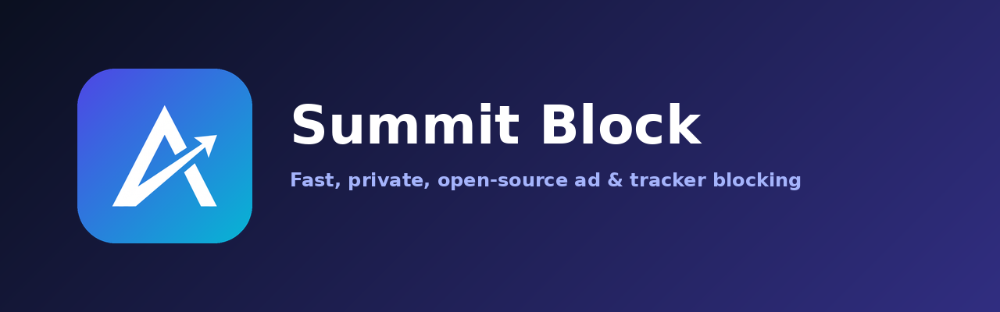
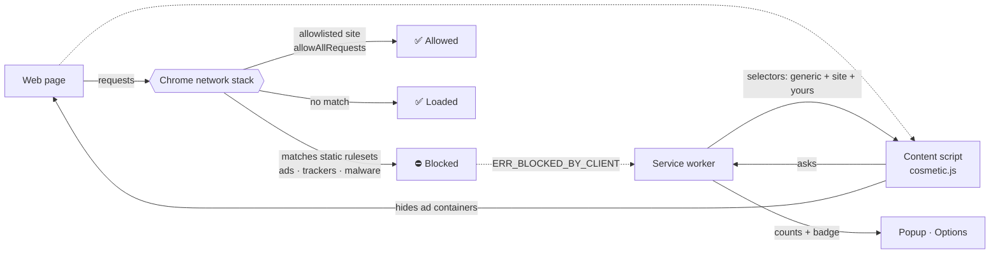

<p align="center">
  
</p>

<h1 align="center">⛰️ Summit Block</h1>

<p align="center">
  <b>Reach the summit of a cleaner web.</b><br>
  A fast, private, open-source ad &amp; tracker blocker for Chrome — built on Manifest V3.
</p>

<p align="center">
  
  
  
  
</p>

---

## ✨ Why Summit Block?

| | |
|---|---|
| 🚀 **Native speed** | Blocking runs inside Chrome's own `declarativeNetRequest` engine – no JavaScript in the request path, no page slowdown. |
| 🔒 **Private by design** | No analytics. No telemetry. No remote lists. No network calls of its own. Everything stays on your machine. |
| 🧩 **Smart cleanup** | Cosmetic filters hide the empty boxes ads leave behind, with per-site rules and your own selectors. |
| 🎯 **Element picker** | Click anything on a page to hide it forever – no CSS knowledge required. |
| ⏸️ **Per-site pause** | One switch to allowlist a site you want to support (or one that breaks). |
| 📊 **Live counters** | Badge on the toolbar icon, per-page count, and lifetime stats. |
| 💾 **Backup & restore** | Export / import your whole configuration as JSON (validated & sanitised on import). |
| 📜 **Fully documented & legal-ready** | MIT licence, Privacy Policy, Terms, Disclaimer, Security Policy and more – all included. |

## 🚀 Quick start (2 minutes)

1. **Unzip** the project.
2. Open **`chrome://extensions`** and switch on **Developer mode** (top-right).
3. Click **Load unpacked** and select the folder that contains `manifest.json`.
4. Pin the ⛰️ icon and browse – the badge shows how many requests were blocked on the page.

> Works in any Chromium browser (Edge, Brave, Opera, Vivaldi…) the same way. More detail in
> [`docs/INSTALL.md`](docs/INSTALL.md).

## 🧠 How it works



Three layers work together:

1. **Network layer** – three bundled rulesets (`ads`, `trackers`, `malware`) compiled from the
   plain-text lists in `filters/`. Chrome applies them natively.
2. **Cosmetic layer** – a tiny content script hides ad slots and leftovers with one injected
   stylesheet, using selectors served by the background worker.
3. **User layer** – allowlist, custom blocked domains and picked elements, applied as dynamic
   rules and per-site selectors.

## 🗂️ Project structure

```text
summit-block/
├── manifest.json                 # MV3 manifest (permissions, rulesets, scripts)
├── src/
│   ├── background/
│   │   ├── service-worker.js     # orchestration, messaging, context menus
│   │   ├── rules.js              # settings → declarativeNetRequest rules
│   │   └── stats.js              # block counter + toolbar badge
│   ├── content/
│   │   ├── cosmetic.js           # hides ad containers (document_start)
│   │   ├── picker.js             # click-to-hide element picker
│   │   └── youtube.js            # experimental YouTube ad skipper
│   ├── popup/                    # toolbar popup (html/css/js)
│   ├── options/                  # full settings page (html/css/js)
│   ├── shared/                   # constants, storage + sanitiser, domain helpers
│   ├── rules/                    # GENERATED static rulesets (ads/trackers/malware)
│   └── data/cosmetic-filters.json
├── filters/                      # human-editable filter lists (source of truth)
├── scripts/                      # build-rules · validate · package · icons · personalize
├── tests/                        # Node + Python unit tests
├── docs/                         # INSTALL · ARCHITECTURE · FILTERS · STORE_LISTING
├── legal/                        # Privacy · Terms · Disclaimer · Third-party notices
├── assets/                       # logo, icons, banner, store promo images
├── LICENSE  SECURITY.md  CODE_OF_CONDUCT.md  CONTRIBUTING.md  CHANGELOG.md
└── .github/                      # issue & PR templates
```

## 🛠️ Developer commands

```bash
python3 scripts/build-rules.py    # filters/*.txt  →  src/rules/*.json
python3 scripts/validate.py       # checks manifest paths, rules, legal files
npm test                          # Node + Python unit tests
bash scripts/package.sh           # store-ready zip in dist/
python3 scripts/generate-icons.py # rebuild icons/banner from assets/source/ (needs pillow)
```

## ➕ Add your own filters

Edit a list in `filters/` and rebuild:

```text
||ads.example.com^                 # domain + all subdomains
||tracker.example.net^$third-party # only when embedded on other sites
||example.org/banners/             # URL prefix
```

```bash
python3 scripts/build-rules.py   # then click "Reload" on chrome://extensions
```

Hiding a specific page element? Use the **Block an element** button in the popup – or add a
selector in **Options → My filters**. Full guide: [`docs/FILTERS.md`](docs/FILTERS.md).

## 🔐 Privacy at a glance

- Settings & counters live in `chrome.storage.local` — never synced, never uploaded.
- The `webRequest` permission is used **only** to notice that a request was blocked so a *number*
  can go up by one. URLs are never read or stored.
- No remote code, no `eval`, no inline scripts.

Read the full [Privacy Policy](legal/PRIVACY_POLICY.md).

## ⚠️ Honest limitations

- The bundled lists are a **compact, hand-curated starter set** (a few dozen well-known ad,
  tracker and miner domains) – not a replacement for the 100k-rule lists of mature blockers.
  Extending them is easy (see above); Chrome allows at least 30,000 static rules.
- Manifest V3 cannot do everything MV2 blockers could (no dynamic response filtering), so some
  first-party and server-side-injected ads will slip through.
- The YouTube skipper is best-effort and may break whenever YouTube changes its player; it is
  **off by default**.
- The block counter counts requests Chrome cancelled, so it can include blocks by other extensions.

## ❓ FAQ

<details><summary><b>Will this slow my browser down?</b></summary>
No. Matching happens inside Chrome's native engine. The content script only injects one stylesheet.
</details>

<details><summary><b>A site is broken – what now?</b></summary>
Open the popup and flip the site switch off (or add it in Options → Allowlist). Then open a
"Filter request" issue so the rule can be fixed.
</details>

<details><summary><b>Does hiding cookie banners accept cookies?</b></summary>
No. "Hide annoyances" only hides the dialog visually. The site keeps its own default behaviour.
</details>

<details><summary><b>Can I publish this to the Chrome Web Store?</b></summary>
Yes – run <code>bash scripts/package.sh</code>, host the Privacy Policy at a public URL, and use the
text in <a href="docs/STORE_LISTING.md"><code>docs/STORE_LISTING.md</code></a> (single-purpose
statement and permission justifications included).
</details>

## 🗺️ Roadmap

- [ ] Optional, user-initiated filter-list import (EasyList-compatible subset)
- [ ] Per-site element-hiding editor with live preview
- [ ] Localisation (Sinhala, Tamil, Spanish…)
- [ ] Dark/light popup theme switch
- [ ] Firefox build

## ⚖️ Legal

| Document | |
|---|---|
| [LICENSE](LICENSE) | MIT |
| [Privacy Policy](legal/PRIVACY_POLICY.md) | zero data collected |
| [Terms of Service](legal/TERMS_OF_SERVICE.md) | |
| [Disclaimer](legal/DISCLAIMER.md) | no warranty · trademarks |
| [Third-Party Notices](legal/THIRD_PARTY_NOTICES.md) | no bundled third-party code |
| [Security Policy](SECURITY.md) | responsible disclosure |
| [Code of Conduct](CODE_OF_CONDUCT.md) | |

Before publishing, replace the placeholder contact details:
`python3 scripts/personalize.py --email you@domain.com --github AmareDev2k`

## 🤝 Contributing

PRs, filter fixes and ideas are very welcome – see [CONTRIBUTING.md](CONTRIBUTING.md).

## ☕ Support the project

<div align="center">
  <p>If Summit Block is useful to you, you can support its continued development:</p>
  <a href="https://buymeacoffee.com/supunaravid">
    
  </a>
  <a href="https://www.patreon.com/cw/aravinda_dev2004/membership">
    
  </a>
</div>

---

<p align="center">Made with ☕ and a lot of blocked pixels · © 2026 Aravinda · MIT</p>
