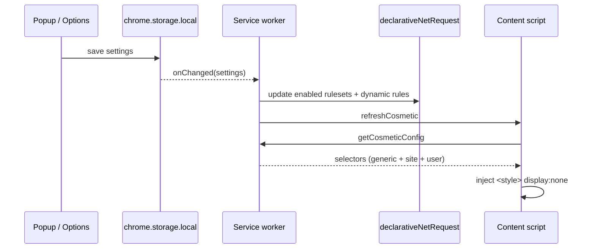

# Architecture

## Components

| Component | File(s) | Runs in | Job |
|---|---|---|---|
| Service worker | `src/background/service-worker.js` | background | Syncs rules with settings, answers content-script messages, context menus, badge/icon |
| Rule sync | `src/background/rules.js` | background | Enables/disables static rulesets; builds dynamic rules (allowlist, custom blocks) |
| Stats | `src/background/stats.js` | background | Counts `ERR_BLOCKED_BY_CLIENT` events per tab + lifetime |
| Cosmetic engine | `src/content/cosmetic.js` | every frame, `document_start` | Injects one `<style>` hiding ad selectors |
| Element picker | `src/content/picker.js` | on demand | Lets the user click an element; stores a CSS selector |
| YouTube skipper | `src/content/youtube.js` | youtube.com | Optional ad skipping |
| Popup | `src/popup/*` | toolbar popup | On/off, per-site pause, counters |
| Options | `src/options/*` | tab | Lists, allowlist, custom filters, backup |
| Shared | `src/shared/*` | everywhere | Constants, storage + sanitiser, hostname helpers |

## Data flow

**Single reactive path:** the UI only writes settings. The service worker reacts to
`storage.onChanged` and applies everything, so the popup, options page and context menu can never
get out of sync.

## Rule model

- **Static rulesets** (`src/rules/*.json`, generated): one rule holds up to 100 domains in
  `requestDomains`, priority 1, action `block`, all resource types except `main_frame`.
- **Dynamic rules**: allowlist → `allowAllRequests` (priority 1000) for the site's frames;
  custom domains → `block` (priority 1). Dynamic rule ids start at 1000 and 100000.
- `allowAllRequests` outranks every `block`, which is how per-site pausing works.

## State & storage

| Key | Area | Content |
|---|---|---|
| `settings` | local | Sanitised settings object (see `shared/storage.js`) |
| `stats` | local | `{ total, since }` |
| `tabCounts` | session | `{ [tabId]: number }` – survives service-worker restarts |

The service worker is stateless: it can be killed at any time and rebuilds everything from storage.

## Security decisions

- Every read of `settings` passes through `sanitizeSettings()`; imports use the same function.
- Custom selectors are length-limited and validated with `querySelector` before use.
- The host for a saved selector is derived from `sender.tab.url`, never from message payloads.
- No `innerHTML` with dynamic data; no `eval`; no remote code; default extension CSP.
- `webRequest` is used read-only (`onErrorOccurred`) and only the error code and tab id are used.
